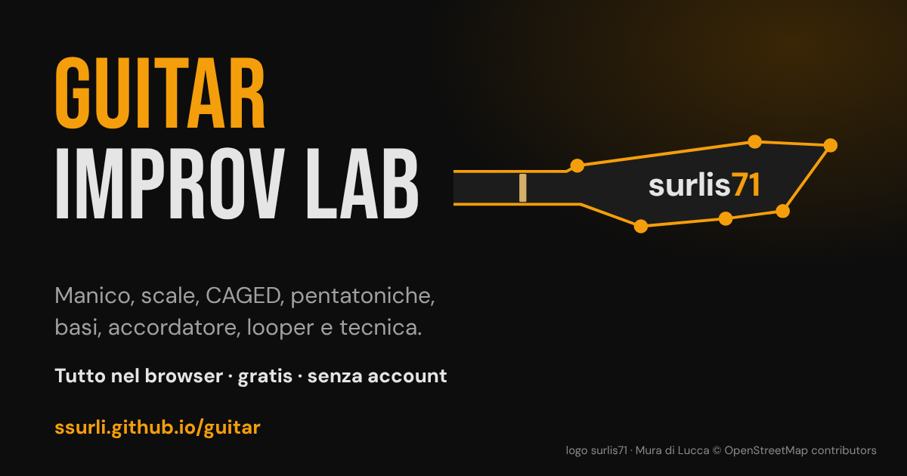

# 🎸 Guitar Improv Lab

**Laboratorio per chitarristi che gira tutto nel browser:** manico interattivo, scale e modi, CAGED, pentatoniche, basi per improvvisare, accordatore, looper e tecnica avanzata. L'audio è sintetizzato al momento con la Web Audio API: non c'è nulla da installare e non serve un account.

**▶ Provalo:** https://ssurli.github.io/guitar/



---

## Cosa c'è dentro

L'app è organizzata in quattro sezioni, raggiungibili dalla barra in basso su smartphone o dal menu in alto su desktop.

| Sezione | Contenuto |
|---|---|
| **Setlist** | Il tuo repertorio. Ogni canzone ha tonalità, accordi e un «Suona ora» che avvia la base. Le scorciatoie *Studia in…* portano a Manico, CAGED, Target-tone e Drill nella tonalità e nel modo della canzone; ✨ rileva tonalità e modo dagli accordi, blues compreso. |
| **Manico** | **Fretboard**: scale e modi su tutto il manico, con le note colorate per funzione (tonica, 3ª, 5ª, 7ª), modalità 3 note per corda e palette per daltonici o ad alto contrasto. **Scale & Accordi**: modi, progressioni, triadi e settime con le inversioni sui set di corde. **CAGED**. **5 box pentatonici**. **Circolo delle quinte**. |
| **Suona** | **Basi** generate in tempo reale (batteria, basso, accordi) per tonalità, modo e stile, o da una progressione scritta da te, con il manico che segue l'accordo che sta suonando. **Accordatore** con accordature alternative. **Manico live**: la nota che suoni si accende sul manico. **Looper** con overdub, che si aggancia alla base e registra giri di battute intere. **Suono**: riverbero e distorsione. |
| **Allena** | **Tecnica avanzata**: alternate e inside/outside picking, legato, tapping, string skipping, DWPS, sweep, Equator Trick (John Mayer), double stops e **pentatoniche dominanti** (Eric Johnson, John McLaughlin) nelle 5 posizioni, ciascuna con tablature e Play; durante il Play si accende il pallino della nota. **Coscienza del manico**: drill brevi con ripetizione spaziata. |

Una **tonalità unica**, scelta nell'header, vale per tutte le viste.

## Requisiti

**Per usarla:**
- Un browser recente: Chrome, Edge, Firefox o Safari, da desktop o smartphone (iOS 15.4 o successivo).
- Per accordatore, Manico live e looper serve il **permesso del microfono**. I browser lo concedono solo su **HTTPS** o su `localhost`. Su GitHub Pages funziona già.
- Per looper e overdub usa le **cuffie**: con gli altoparlanti il microfono riprende anche il loop. Con le cuffie Bluetooth alza la *compensazione latenza* del looper.
- Una connessione serve solo per i font (Google Fonts) e per il collegamento facoltativo a [Guitarzorn](https://github.com/ssurli/guitarzorn). L'audio funziona anche offline.

**Per lavorarci sul codice:**
- Nessuna build e nessuna dipendenza da installare: l'app è un unico `index.html` con CSS e JavaScript inline, più qualche modulo in `js/`.
- [Node.js](https://nodejs.org/) 18 o successivo, solo per lanciare i test.
- Python 3, o qualsiasi server statico, per provarla in locale.

## Avvio in locale

```bash
git clone https://github.com/ssurli/guitar.git
cd guitar
python3 -m http.server 8000
# apri http://localhost:8000
```

Su `localhost` il microfono funziona come in HTTPS. Aprire `index.html` con doppio clic va bene per tutto tranne il microfono.

## Test

I test coprono la logica pura (teoria del manico, rilevamento dell'intonazione, motore didattico, ripetizione spaziata, migrazione dei dati della setlist). Usano solo `node:assert`:

```bash
for t in test/*.js; do node "$t" || echo "FALLITO: $t"; done
```

## Struttura

```
index.html            l'app: markup, stile e logica
js/
  fretboard-theory.js teoria: note, intervalli, scale sul manico
  pitch-loop.js       rilevamento dell'intonazione dal microfono (DSP)
  pedagogy-engine.js  motore dei drill «Coscienza del manico»
  srs-analytics.js    ripetizione spaziata e statistiche
  songlab-store.js    archivio della setlist (localStorage) e migrazioni
  fc-ui.js            interfaccia dei drill
songs.js              repertorio iniziale (accordi delle canzoni)
test/                 test con node:assert
docs/                 note di progetto e audit UX (euristiche, architettura dell'informazione)
guitar-improv.html    vecchio indirizzo, reindirizza a index.html
```

## Privacy

Non si raccoglie nessun dato e non c'è nessun account. Setlist, preferenze e progressi restano nel `localStorage` del tuo browser. L'audio del microfono viene analizzato sul tuo dispositivo e non viene inviato da nessuna parte.

## Pubblicazione

Il sito viene servito da **GitHub Pages** dal branch `main`. Un merge su `main` aggiorna https://ssurli.github.io/guitar/ in un paio di minuti.

## Progetti collegati

- [ChordLab](https://ssurli.github.io/chordlab/): accordi e setlist
- [Guitarzorn](https://github.com/ssurli/guitarzorn): i riff tradotti in pittura

## Logo

Il logo **surlis71** è una paletta di chitarra con sei baluardi delle Mura di Lucca al posto delle sei meccaniche, uno per corda. Il manico entra dal baluardo San Donato. Le posizioni dei baluardi derivano da dati © [OpenStreetMap contributors](https://www.openstreetmap.org/copyright) (ODbL). File: `favicon.svg`, `apple-touch-icon.png`, `og-image.png`.

## Licenza

Codice [MIT](LICENSE) © 2026 Stefano Surlinelli. Il nome e il logo surlis71 non rientrano nella licenza: puoi riusare il codice, ma non presentarlo con questo logo.
